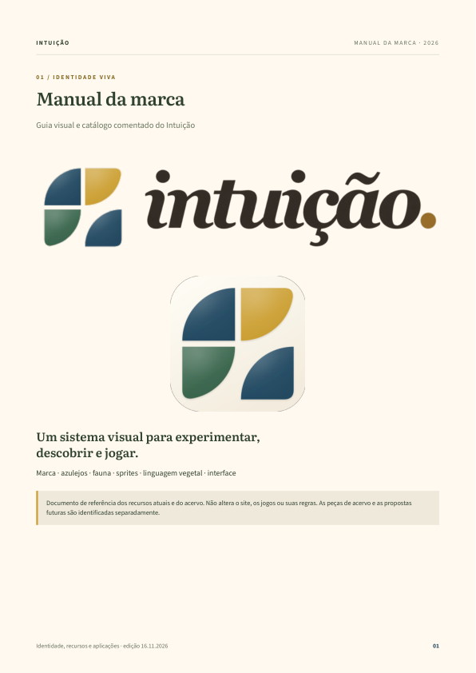
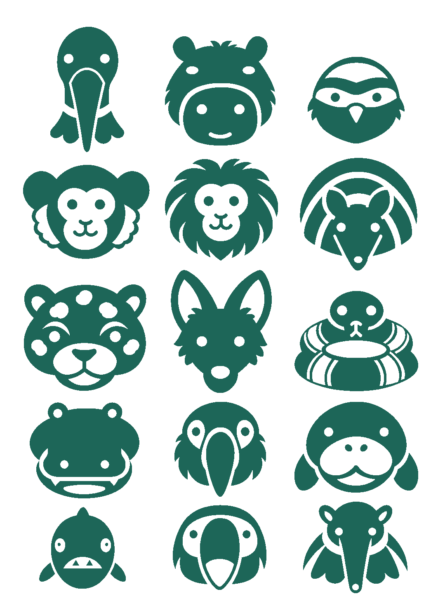
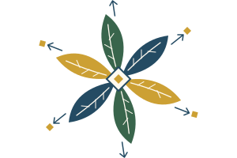
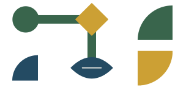
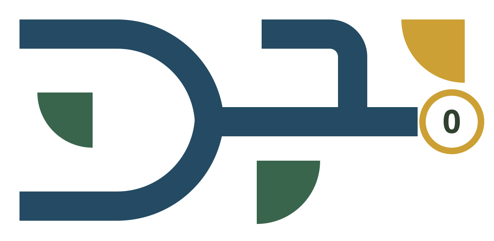

# Arte conceitual dos projetos

## Critério editorial

Esta galeria complementa as logos e os diagramas documentados em [Imagens dos projetos](IMAGENS-DOS-PROJETOS.md). Não contém capturas de interface, prévias descartadas, cursores ou imagens privadas. A arte original foi copiada sem redesenho, recoloração ou mudança de proporção. Não há criação de nova marca.

## Intuição: biblioteca visual e identidade

As cinco imagens abaixo são cópias byte a byte dos arquivos públicos do próprio projeto. A conferência foi feita contra o conteúdo de `main` retornado pelo GitHub em 16/11/2026; os identificadores de blob abaixo permitem conferir a versão exata mesmo que `main` mude.

| Arquivo local                                            | Conteúdo e uso indicado                                                                                                | Origem pública                                                                                                                                | Git blob SHA-1                             |
| -------------------------------------------------------- | ---------------------------------------------------------------------------------------------------------------------- | --------------------------------------------------------------------------------------------------------------------------------------------- | ------------------------------------------ |
| `public/images/projects/art/intuicao-manual-marca.png`   | Capa real do manual da marca. Usar junto ao link para a biblioteca/manual, não como screenshot do jogo.                | [Capa](https://github.com/luigiscofano/intuicao/blob/main/docs/identidade/manual/capa.png)                                                    | `5b3692cca98c66e8ea73ad224372026946fc82d5` |
| `public/images/projects/art/intuicao-fauna-original.png` | Prancha original dos 15 mascotes, frente, verde sobre branco. Exibir inteira em galeria expandida, sem cortar animais. | [Fauna](https://github.com/luigiscofano/intuicao/blob/main/docs/identidade/manual/assets/Intuicao_Icones_Fauna_Frente_Verde_sobre_Branco.png) | `6bb5436757f5726743095214670a3c49faef880c` |
| `public/images/projects/art/intuicao-estalo-aiij.svg`    | AIIJ aprovada do Estalo, Rosácea de impulso. Arte abstrata e vegetal, não representação do tabuleiro.                  | [Estalo](https://github.com/luigiscofano/intuicao/blob/main/dist/platform-assets/estalo-aiij-aprovada.svg)                                    | `24432c58dcb49d6957a040281e8984430633e42d` |
| `public/images/projects/art/intuicao-renovo-aiij.svg`    | AIIJ original do Renovo, linguagem de folhas e crescimento.                                                            | [Renovo](https://github.com/luigiscofano/intuicao/blob/main/dist/platform-assets/renovo-aiij-c1.svg)                                          | `7feab67e2acc5d85348523908f9713c48ea50b35` |
| `public/images/projects/art/intuicao-foz-aiij.svg`       | AIIJ original do Foz, mosaico com referência à água.                                                                   | [Foz](https://github.com/luigiscofano/intuicao/blob/main/dist/platform-assets/foz-aiij-mosaico.svg)                                           | `fce54a161a1fc8d560b3fa0f3d68bd8465b79d56` |

### Integração recomendada

- Manter a logo oficial existente como primeira imagem do projeto.
- Na biblioteca, usar a capa com o nome “Manual da marca” e acesso ao [PDF original](https://github.com/luigiscofano/intuicao/blob/main/docs/identidade/manual/Intuicao_Manual_da_Marca_2026.pdf).
- Exibir as AIIJs em uma faixa compacta apenas quando a seção do projeto for expandida. `object-fit: contain`, sem filtro de cor, sem esticar ou cortar a arte.
- A prancha da fauna é vertical: reservar visualização ampliada para manter legibilidade sem alongar a página inicial.
- A capa também mostra o ícone aprovado do futuro aplicativo. Isso não afirma que existe aplicativo publicado.

### Direitos e limites

A reutilização atende ao pedido do titular para o próprio portfólio. A MIT do código não deve ser apresentada como licença automática das marcas e imagens. A documentação original registra pendências documentais de autoria; este trabalho não as resolve nem certifica propriedade intelectual. Referência: [manual e proveniência](https://github.com/luigiscofano/intuicao/blob/main/docs/identidade/manual/README.md).

## Demais projetos: curadoria sem imagens inventadas

Os diagramas reais de Métodos Numéricos, Sistemas Digitais, Sistemas de Programação, Algoritmos, POO e Lista 08 já existentes no portfólio são adequados como imagens conceituais. Não é necessário substituí-los por imagens genéricas. Tupi e Kaggle já têm capas/arte próprias; Pokédex tem ícone próprio. Preservar o recorte aprovado da marca Trilha Viva, nunca mostrar a prancha inteira com opções descartadas.

GestureLab e Tetris não receberam imagem nova nesta entrega: as opções previamente disponíveis eram prévias de execução, incompatíveis com a instrução atual. Para esses dois, uma ilustração técnica só deve ser adicionada após validar no código a mecânica ou pipeline que ela representa; não usar uma marca inventada ou promessa visual de funcionalidade.

## Verificações

- Cinco originais comparados por hash de blob Git com os arquivos públicos correspondentes: todos idênticos.
- Capa e prancha da fauna inspecionadas visualmente; não contêm ponteiro nem dados pessoais.
- SVGs originais usados como recursos de imagem, nunca como HTML executável; sem scripts ou referências externas no conjunto copiado.
- Total dos cinco arquivos: 148.361 bytes. Nenhuma dependência nova, alteração de aplicação, commit ou publicação nesta entrega de assets.
