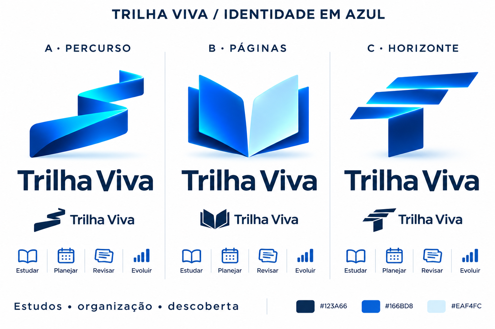
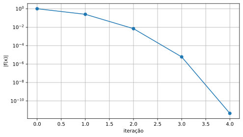
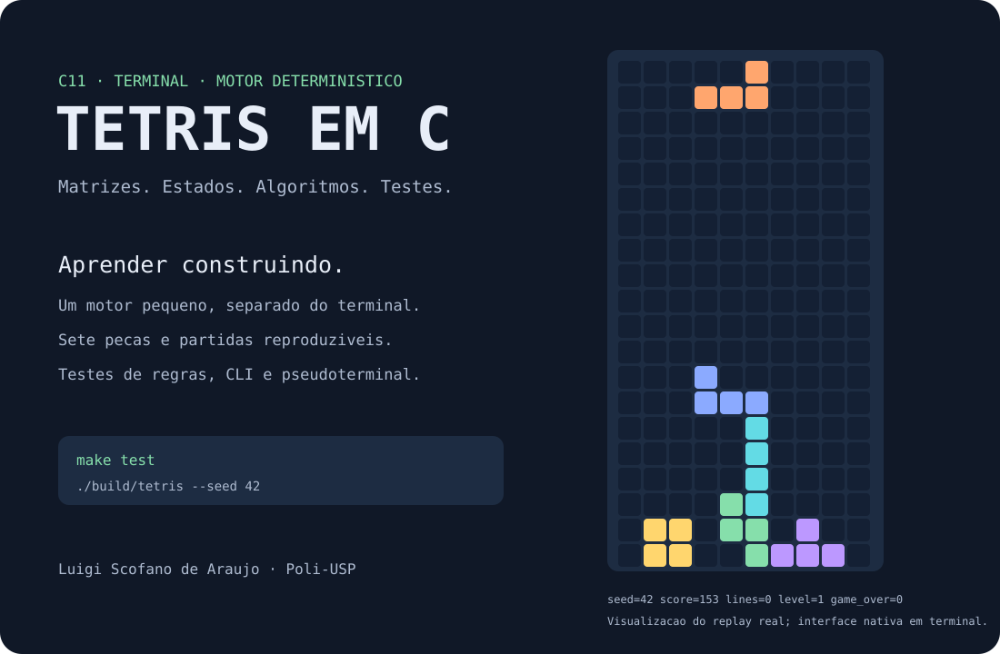
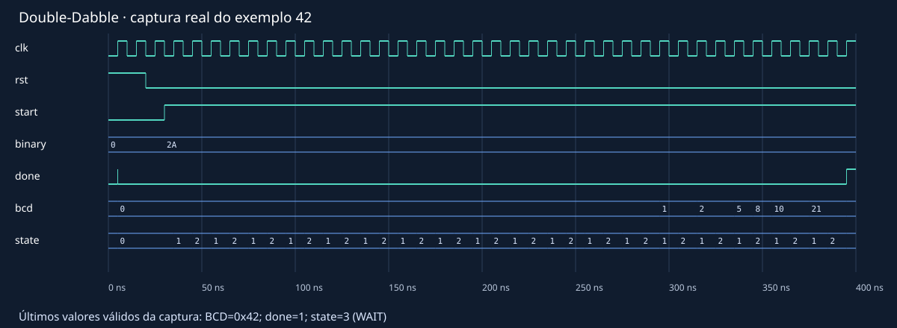
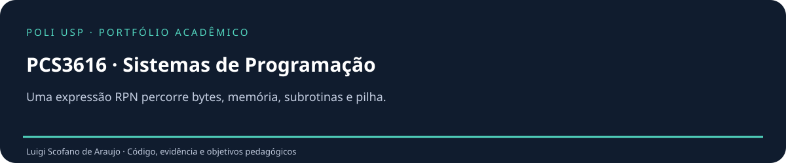
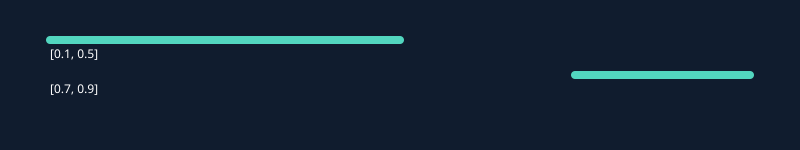
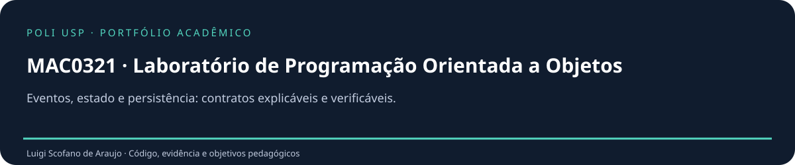
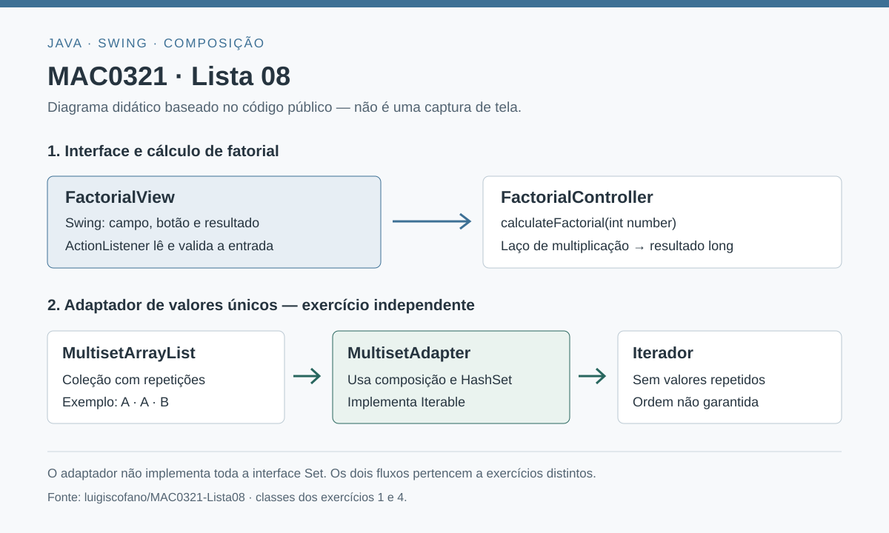
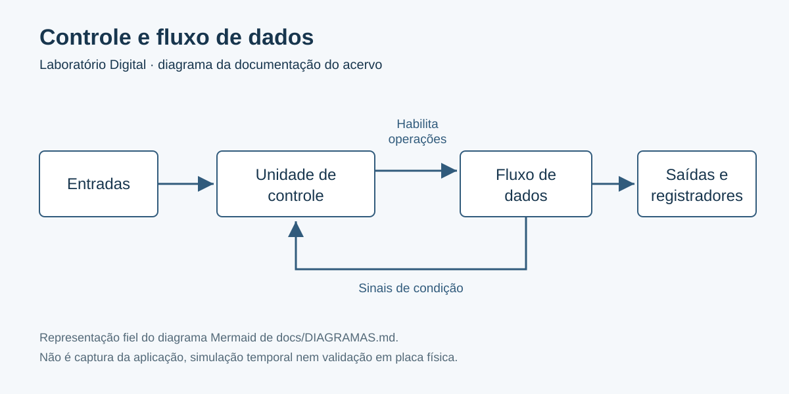

# Imagens dos projetos

## Critérios

Imagens complementam as seções expandidas, sem inflar a entrada do portfólio. Os textos alternativos informam o tipo de imagem. Não usamos fotos de ambientes internos nem capturas de dados privados de empregadores. Nenhuma imagem abaixo comprova funcionalidades além do escopo documentado.

## Oito projetos complementados

### Trilha Viva

- **Arquivo local:** `public/images/projects/trilha-viva-identidade.png`
- **Dimensões:** 1536 × 1024
- **Tipo:** Prancha original de identidade; a opção B é a adotada, não é captura de aplicação.
- **Fonte:** [referência pública](https://github.com/luigiscofano/trilha-viva/blob/88553d52e4b3efad917c576b4774738255623306/assets/brand-approved-board.png)

### Métodos Numéricos

- **Arquivo local:** `public/images/projects/metodos-numericos-convergencia.svg`
- **Dimensões:** 496 × 279
- **Tipo:** Gráfico produzido pelos experimentos, não captura de interface.
- **Fonte:** [referência pública](https://github.com/luigiscofano/usp-metodos-numericos/blob/5b9a625ba1f065884c054d0fdc6d11cfe258bf7f/assets/figuras/02_convergencia.svg)

### Tetris em C

- **Arquivo local:** `public/images/projects/tetris-replay.svg`
- **Dimensões:** 1100 × 720
- **Tipo:** Visualização documentada de um replay real; a aplicação original roda em terminal.
- **Fonte:** [referência pública](https://github.com/luigiscofano/tetris-c/blob/5c8995868ad3e1b1162c0fcd4b4e599adae8da45/assets/preview.svg)

### Sistemas Digitais II

- **Arquivo local:** `public/images/projects/sistemas-digitais-double-dabble.svg`
- **Dimensões:** 1200 × 440
- **Tipo:** Diagrama de sinais da simulação Double-Dabble, não validação de placa física.
- **Fonte:** [referência pública](https://github.com/luigiscofano/usp-pcs3225-sistemas-digitais/blob/b6d14a4c94d892b010676aa4b76b008afaa20e22/assets/double_dabble_42.svg)

### Sistemas de Programação

- **Arquivo local:** `public/images/projects/sistemas-programacao-capa.svg`
- **Dimensões:** 1200 × 250
- **Tipo:** Capa documental original.
- **Fonte:** [referência pública](https://github.com/luigiscofano/usp-pcs3616-sistemas-programacao/blob/fcac02fd059b80f5af2659e107ad9a3aa66cf5ea/assets/capa.svg)

### Algoritmos e estruturas de dados

- **Arquivo local:** `public/images/projects/algoritmos-uniao-intervalos.svg`
- **Dimensões:** 800 × 150
- **Tipo:** Figura didática de união de intervalos.
- **Fonte:** [referência pública](https://github.com/luigiscofano/usp-mac0122-algoritmos/blob/151b801809a8385b95d5221eb0068ec80aa84087/assets/uniao_intervalos.svg)

### Programação Orientada a Objetos

- **Arquivo local:** `public/images/projects/poo-capa.svg`
- **Dimensões:** 1200 × 250
- **Tipo:** Capa documental original.
- **Fonte:** [referência pública](https://github.com/luigiscofano/usp-mac0321-poo/blob/558f044476d78659c2792bae1ba088d973a30c46/assets/capa.svg)

### MAC0321 · Lista 08

- **Arquivo local:** `public/images/projects/lista08-swing-adapter.svg`
- **Dimensões:** 1200 × 720
- **Tipo:** Diagrama didático novo baseado no código público, não captura de execução.
- **Fonte:** [referência pública](https://github.com/luigiscofano/MAC0321-Lista08/tree/master/src/br/usp/ime/mac321/lista08)

## Proveniência e limites

As sete imagens originais têm fontes fixadas em commits públicos para rastrear a versão copiada. Os SVGs foram verificados quanto à ausência de scripts, atributos de evento, foreignObject e referências externas de carregamento. O namespace XML padrão não é um recurso carregado.

A prancha do Trilha Viva foi inspecionada visualmente e não contém cursor. A captura pública painel.jpg foi descartada deste portfólio porque contém um cursor sobre Fonte disponível. A prancha não deve ser descrita como captura atual da aplicação e mostra alternativas históricas; a marca B — Páginas é a escolhida.

O diagrama Lista 08 representa dois exercícios independentes: FactorialView usa FactorialController para calcular fatorial; MultisetAdapter recebe MultisetArrayList e retorna iterador de valores únicos por HashSet. A ordem não é garantida e a classe não implementa toda a interface Set. Fontes: [FactorialView](https://github.com/luigiscofano/MAC0321-Lista08/blob/master/src/br/usp/ime/mac321/lista08/ex1/FactorialView.java), [FactorialController](https://github.com/luigiscofano/MAC0321-Lista08/blob/master/src/br/usp/ime/mac321/lista08/ex1/FactorialController.java), [MultisetAdapter](https://github.com/luigiscofano/MAC0321-Lista08/blob/master/src/br/usp/ime/mac321/lista08/ex4/MultisetAdapter.java). Autoria acadêmica do código: Luigi Scofano de Araujo e Hugo Spadete.

## Imagens existentes

As imagens existentes foram preservadas. Em especial, a imagem do GestureLab é uma **prévia sintética** do PoseMatch, e não uma captura real de webcam. Seu texto alternativo mantém essa distinção. Capas e figuras didáticas não devem ser apresentadas como telas reais.

## Substituições de capturas com cursor

As capturas anteriores de Pokédex e LabDig continham cursor visível. Os arquivos antigos foram preservados, mas não são mais utilizados no catálogo.

### Pokédex: ícone original

- **Arquivo:** public/images/projects/pokedex-icone-original.svg; 64 × 64, vetorial.
- **Tipo:** ícone original do projeto de fã, não captura da aplicação nem marca oficial Pokémon.
- **Fonte:** [web/icon.svg](https://github.com/luigiscofano/Pokedex/blob/2ca209d175d47ce38c825f9485e29fe8c044aca2/web/icon.svg).
- Copiado sem redesenho. Não contém cursor.

### LabDig: controle e fluxo de dados

- **Arquivo:** public/images/projects/labdig-controle-fluxo.svg; 1200 × 600.
- **Tipo:** representação SVG do diagrama Mermaid original; não captura de tela, onda de simulação ou fotografia de hardware.
- **Fonte:** [docs/DIAGRAMAS.md](https://github.com/luigiscofano/usp-labdig/blob/7696cea8cea57c3c58c45a4a1a4e88167ccb01ba/docs/DIAGRAMAS.md).
- O acervo não contém imagens raster ou SVG neste commit. A apresentação vetorial conserva os quatro nós, as conexões e os dois rótulos do diagrama público: entradas, unidade de controle, fluxo de dados e saídas/registradores; habilitação de operações e retorno dos sinais de condição. Não acrescenta resultados experimentais.
- Não contém cursor, scripts nem recursos externos.

## Direção atual: logos e documentação, nunca prévias

A apresentação atual não exibe capturas, mockups de interface nem pranchas de alternativas. As seções anteriores registram a proveniência histórica dos arquivos, não autorização para exibir todos eles. Os arquivos antigos permanecem no acervo sem necessariamente aparecer no site.

- **Intuição:** logo oficial de azulejos, em SVG, copiada de [docs/identidade/logo-site](https://github.com/luigiscofano/intuicao/blob/938a6f56a87d144bb905190ae7b9e462d4f160c6/docs/identidade/logo-site/intuicao-logo-azulejos.svg). Arquivo local: public/images/projects/intuicao-logo-oficial.svg, 600 × 140.
- **Pokédex:** ícone próprio original verificado, apresentado como logo do projeto de fã.
- **Trilha Viva:** somente símbolo B/Páginas. Não há arquivo separado no repositório original: o próprio site usa a arte original com recorte CSS, sem modificar pixels. O campo imageCrop replica a regra de src/style.css: janela 60 × 41; imagem com largura 242; deslocamento esquerdo −91 e superior −35. A prancha completa NÃO deve ser exibida. Fonte: [brand.mjs](https://github.com/luigiscofano/trilha-viva/blob/88553d52e4b3efad917c576b4774738255623306/src/brand.mjs) e [style.css](https://github.com/luigiscofano/trilha-viva/blob/88553d52e4b3efad917c576b4774738255623306/src/style.css).
- **GestureLab e Tetris:** imagens removidas da apresentação; eram prévia sintética de interface e visualização de replay. Nenhuma logo foi inventada como substituição.
- **Demais projetos:** capas documentais, gráficos ou diagramas classificados como document, não logos. Kaggle é figura geométrica ilustrativa, não resultado de treinamento; Lista08 e LabDig são diagramas didáticos fiéis às fontes, não capturas. Não devem receber rótulos que sugiram aplicação em execução.

imageKind diferencia logo, document e none. imageOmissionReason registra por que um projeto não possui imagem. A interface deve respeitar imageCrop para nunca revelar a prancha de opções do Trilha Viva.
