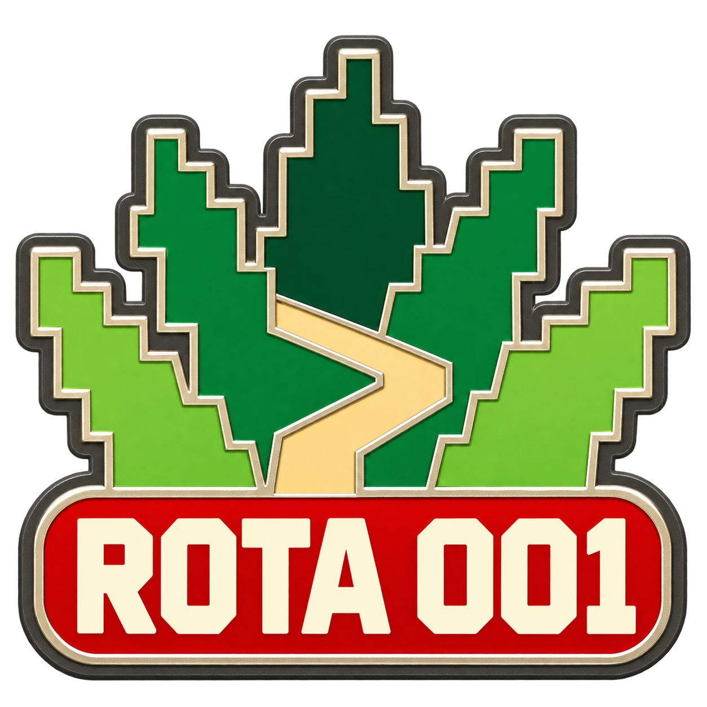

# Pokédex · Rota 001

## Origem e conceito

Arte aprovada pelo autor em 16/11/2026: uma insígnia com mato alto em pixel art, caminho dourado e placa vermelha ROTA 001. A rota remete à exploração e aos primeiros encontros; 001 evoca a primeira entrada da Pokédex Nacional. Não é uma marca oficial de Pokémon.

## Arquivo e aplicação

- Original preservado: `public/images/projects/pokedex-rota-001.png`, 1254 × 1254 pixels, com transparência.
- SHA-256: `dcfcba18024824b1c9b50e0ffca573dd0129d8ce550325479e94769c6af15272`.
- Aplicação: área de marca do cartão Pokédex nos três idiomas, com texto alternativo traduzido.
- O ícone anterior permanece no histórico/acervo; não é mais a marca exibida no cartão.
- Renderização proporcional, sem recorte, recoloração ou simulação de interface.

## Escopo preservado

A assinatura bem-te-vi e o favicon do portfólio não mudam. Screenshots históricos das galerias continuam identificando versões reais capturadas; não são adulterados para simular a marca nova. As regras de navegação, idiomas e abertura de seções permanecem inalteradas.
