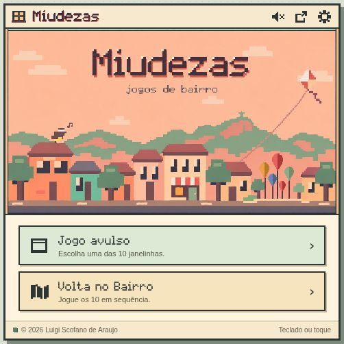
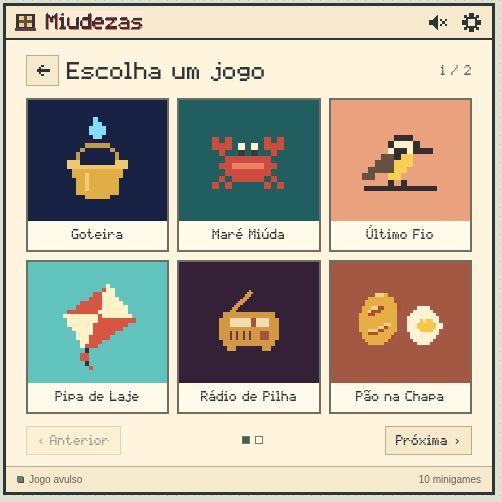
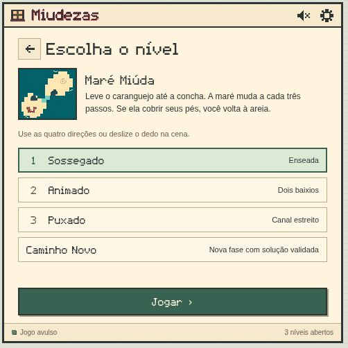
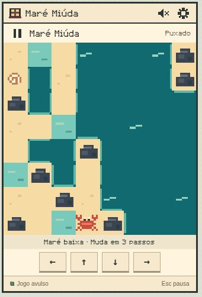
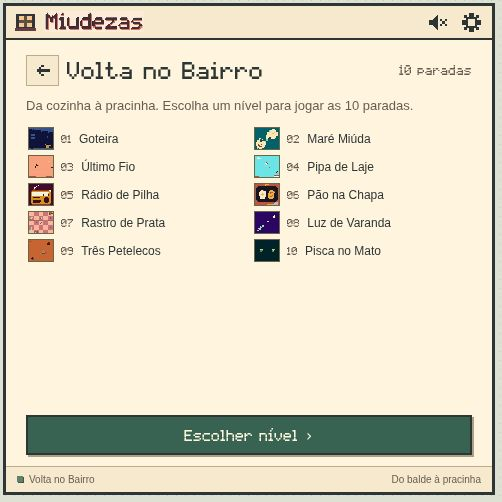
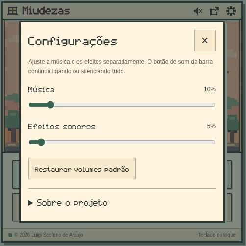

# Miudezas no portfólio

Entrada nos catálogos PT/EN/ES, categoria Software, sem mudanças no layout. A marca abre o cartão; seis capturas reais ficam na galeria expansível. Não há reprodução automática de áudio no portfólio.

## Fontes e imagens

Ativos copiados sem redesenho do commit `37e7d3c4719c27dc12548794ee1c565f873c637c` de [Miudezas](https://github.com/luigiscofano/Miudezas). As capturas de 18/11/2026 documentam navegação real em Chromium desktop, sem cursor, conforme o [registro de origem](https://github.com/luigiscofano/Miudezas/blob/37e7d3c4719c27dc12548794ee1c565f873c637c/docs/imagens/telas/README.md). Não representam teste em aparelho físico.

- Menu inicial e capa inspirada na Tijuca. 

- Seleção dos minigames com ícones próprios. 

- Dificuldades e Caminho Novo de Maré Miúda. 

- Maré Miúda: partida no nível Puxado. 

- Volta no Bairro: percurso com dez paradas. 

- Configurações de música e efeitos sonoros. 

Apenas a captura inicial foi atualizada em **19/11/2026**, a partir do Pages de Miudezas no commit `3f99adfa02325b7db2ed423255afd73f8f17f4a7`. A nova captura contém a capa canônica com duas janelas largas na primeira casa laranja, após recarga sem cache, sem cursor e sem mudança de layout. Mantém 502 × 502 pixels e é idêntica em bytes ao arquivo documental do commit `7d5a5cdd06e58816368777424169e812ae6a675f` de Miudezas. A logo dos cartões e as outras cinco capturas permanecem intactas.

## Manutenção

Atualize os três `content/portfolio*.json`, as legendas PT/EN/ES em `content/project-gallery.json` e os ativos locais juntos. Preserve as fontes versionadas e não apresente renderizações ou mockups como capturas. O progresso do jogo é local, com backup, sem sincronização em conta.

## Verificação

Execute `npm run validate`. Os testes verificam consistência dos idiomas, logo e seis capturas locais com fontes. Confira o cartão e a galeria em desktop e tela estreita antes da publicação.
