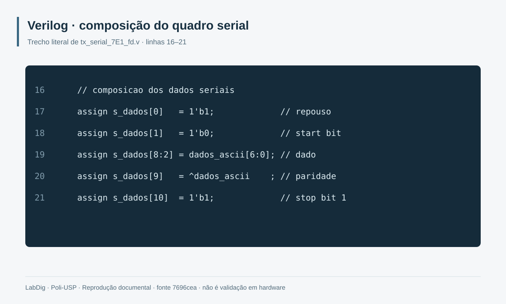
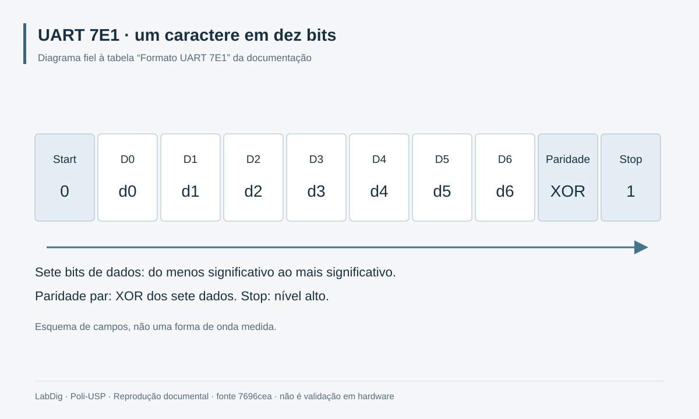
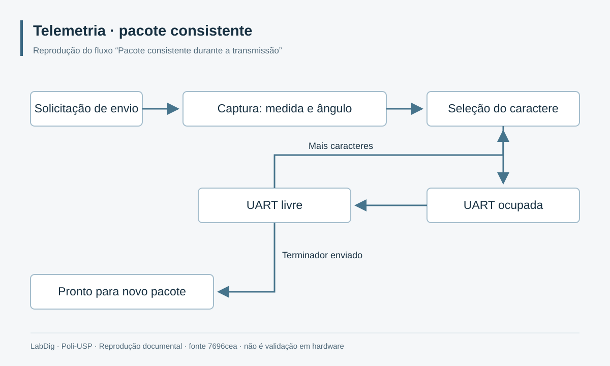
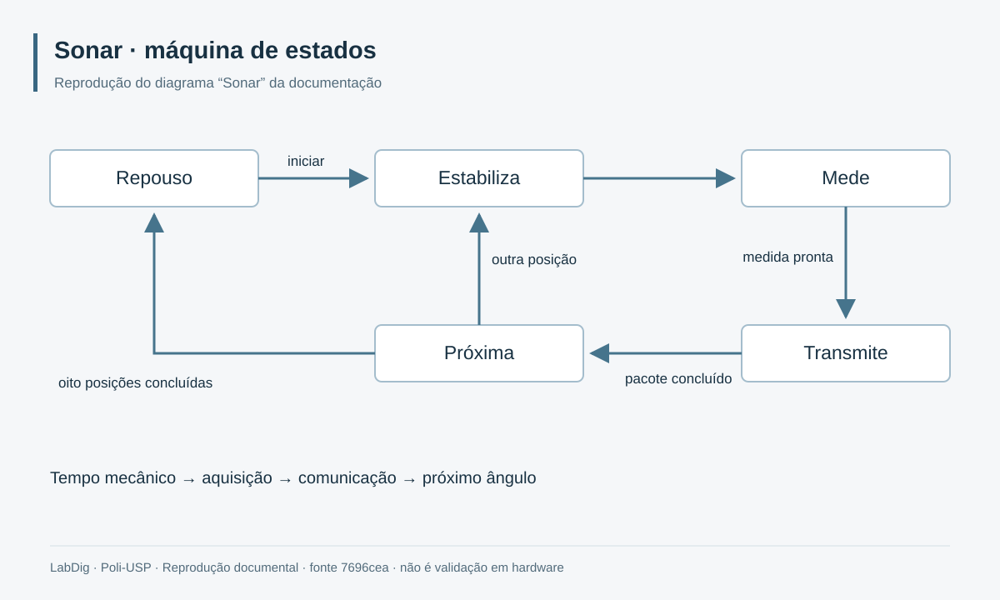

# Galeria documental do LabDig

Quatro novas imagens vetoriais, sem cursor, derivadas de fontes públicas do repositório `usp-labdig`. As três capturas de apresentação anteriores permanecem. Não são fotos de hardware nem resultados novos de simulação.

## labdig-verilog-uart.svg

Trecho literal de Verilog do transmissor UART 7E1, renderizado do código-fonte; não é captura de IDE.

[Fonte imutável](https://github.com/luigiscofano/usp-labdig/blob/7696cea8cea57c3c58c45a4a1a4e88167ccb01ba/labdig-2/experimentos/exp-02/rtl/tx_serial_7E1_fd.v)

## labdig-quadro-uart.svg

Esquema documental do quadro UART 7E1: start, sete bits, paridade par e stop; não é medição.

[Fonte imutável](https://github.com/luigiscofano/usp-labdig/blob/7696cea8cea57c3c58c45a4a1a4e88167ccb01ba/docs/DIAGRAMAS.md)

## labdig-pacote-serial.svg

Fluxo documental de telemetria: captura conjunta de medida e ângulo e transmissão dos caracteres.

[Fonte imutável](https://github.com/luigiscofano/usp-labdig/blob/7696cea8cea57c3c58c45a4a1a4e88167ccb01ba/docs/DIAGRAMAS.md)

## labdig-sonar-estados.svg

Máquina de estados documental do sonar: estabilização, medição, transmissão e oito posições; não é validação física.

[Fonte imutável](https://github.com/luigiscofano/usp-labdig/blob/7696cea8cea57c3c58c45a4a1a4e88167ccb01ba/docs/DIAGRAMAS.md)

O trecho Verilog preserva literalmente as linhas 16–21. Os três diagramas reproduzem campos e transições documentados; apenas a disposição gráfica foi adaptada. As legendas em português, inglês e espanhol distinguem documentação de medições. Os SVGs são locais, sem scripts, dependências externas, imagens privadas ou dados pessoais.
