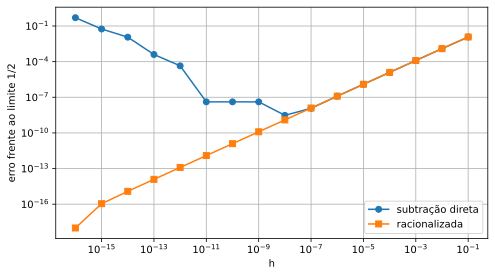
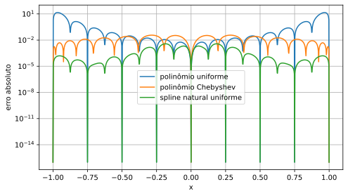

# Galeria de Métodos Numéricos

A galeria mantém as quatro figuras anteriores e acrescenta seis resultados já publicados no [repositório de Métodos Numéricos](https://github.com/luigiscofano/usp-metodos-numericos/tree/5b9a625ba1f065884c054d0fdc6d11cfe258bf7f/assets/figuras). Os SVGs são cópias integrais, sem cursor ou reconstrução estética. As legendas em português, inglês e espanhol identificam a edição de estudo: não são registros históricos da disciplina nem medições físicas.

| Resultado acrescentado         | Imagem                                                                          | Origem                       |
| ------------------------------ | ------------------------------------------------------------------------------- | ---------------------------- |
| Cancelamento e racionalização  |  | Notebook 03, ponto flutuante |
| Aliasing                       |          | Notebook 04, Fourier         |
| Erros de interpolação          |                | Notebook 05, interpolação    |
| Estabilidade                   |  | Notebook 06, EDO             |
| Pêndulo                        |            | Notebook 06, EDO             |
| Resistências no modelo de Chua |          | Notebook 06, EDO             |

## Preservação e desempenho

Não houve mudança de layout, navegação ou interação. A seção continua recolhível, com carregamento tardio e dimensões declaradas. Cada arquivo permanece abaixo do orçamento de 200 kB. Os testes verificam dez itens únicos, referências fixas ao commit de origem e existência dos arquivos.

[Voltar ao README](../README.md)
