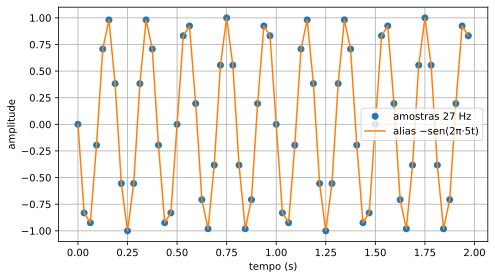
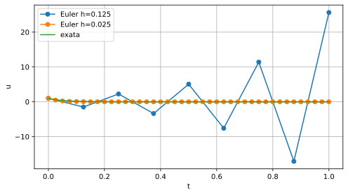
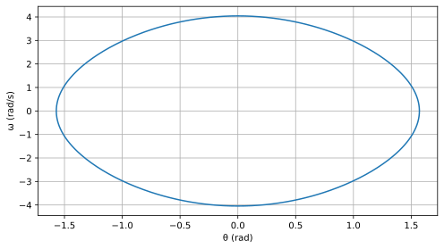
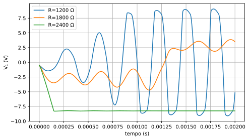
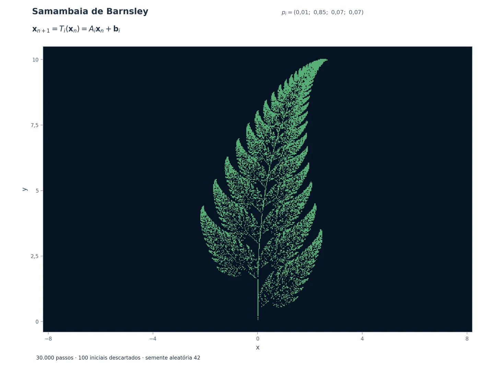
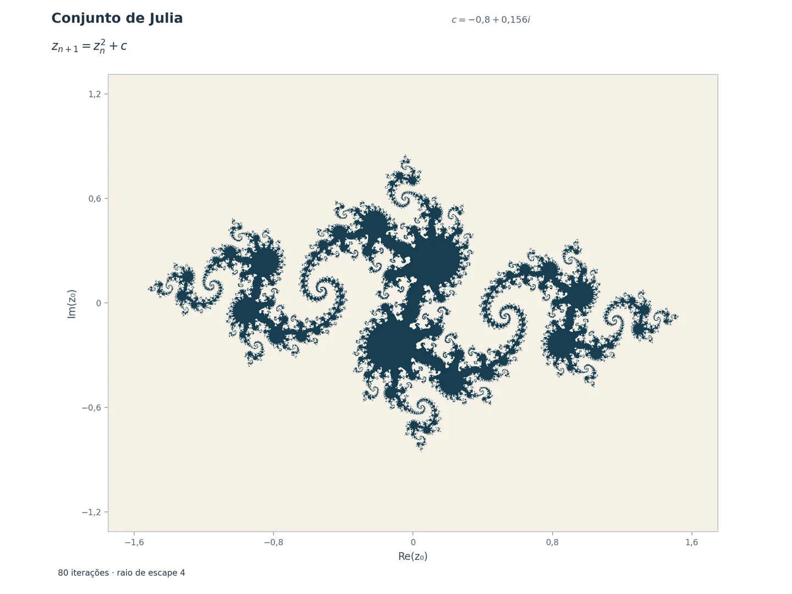
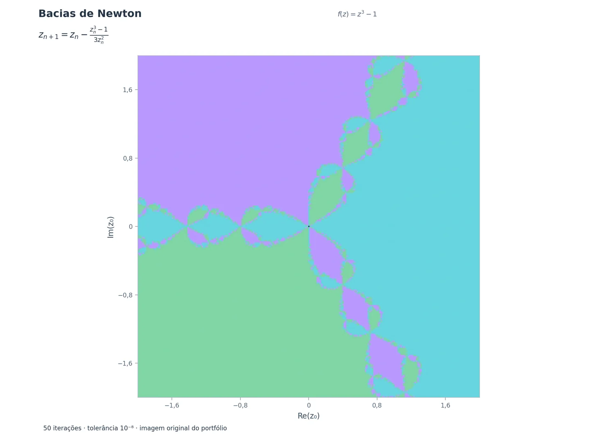
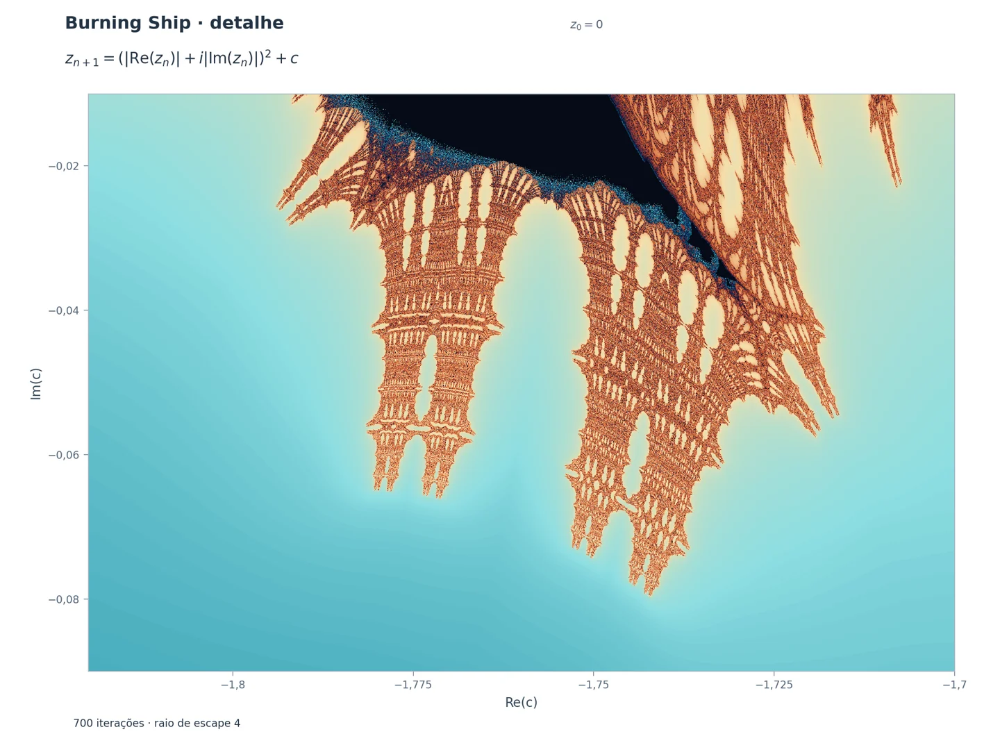
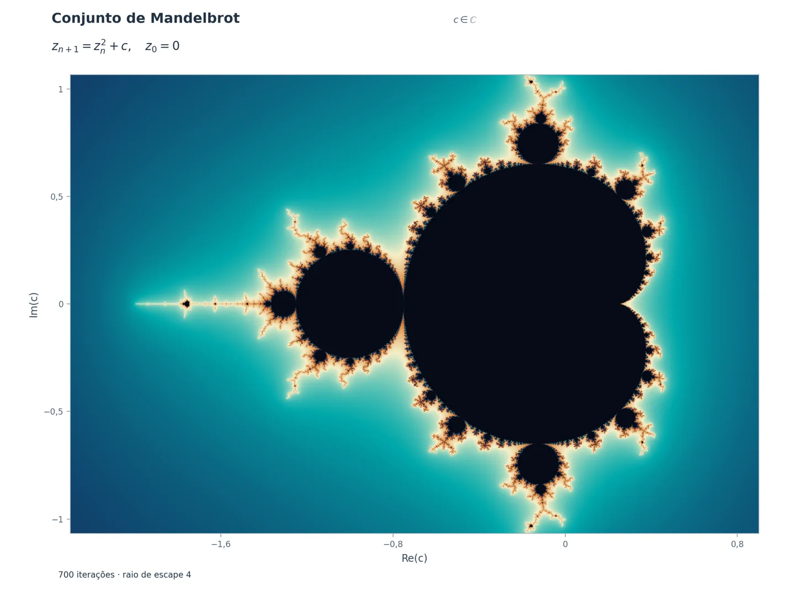

# Galeria de Métodos Numéricos

A galeria mantém as quatro figuras anteriores e acrescenta seis resultados já publicados no [repositório de Métodos Numéricos](https://github.com/luigiscofano/usp-metodos-numericos/tree/5b9a625ba1f065884c054d0fdc6d11cfe258bf7f/assets/figuras). Os SVGs são cópias integrais, sem cursor ou reconstrução estética. As legendas em português, inglês e espanhol identificam a edição de estudo: não são registros históricos da disciplina nem medições físicas.

| Resultado acrescentado         | Imagem                                                                          | Origem                       |
| ------------------------------ | ------------------------------------------------------------------------------- | ---------------------------- |
| Cancelamento e racionalização  |  | Notebook 03, ponto flutuante |
| Aliasing                       |          | Notebook 04, Fourier         |
| Erros de interpolação          |                | Notebook 05, interpolação    |
| Estabilidade                   |  | Notebook 06, EDO             |
| Pêndulo                        |            | Notebook 06, EDO             |
| Resistências no modelo de Chua |          | Notebook 06, EDO             |

## Preservação e desempenho

Não houve mudança de layout, navegação ou interação. A seção continua recolhível, com carregamento tardio e dimensões declaradas. Cada arquivo permanece abaixo do orçamento de 200 kB. Os testes verificam quatorze itens únicos, referências fixas ao commit de origem e existência dos arquivos.

[Voltar ao README](../README.md)

## Fractais: coleção aprovada

As cinco imagens abrem a galeria nesta ordem: **Samambaia de Barnsley, Julia, Newton, Burning Ship e Mandelbrot**. Substituem as miniaturas anteriores de Barnsley e Newton, sem apagar seus arquivos originais e sem duplicar os mesmos resultados. Os outros nove gráficos continuam na galeria.

São cópias WebP de exibição (1440 × 1080, abaixo de 200 kB cada) dos PNGs aprovados, com título, fórmula e eixos. Não há recorte nem cursor. [Originais em alta resolução e documentação](https://github.com/luigiscofano/usp-metodos-numericos/tree/main/assets/fractais).

| Figura | Parâmetros e procedência |
| --- | --- |
| Samambaia de Barnsley | 30.000 passos, 100 iniciais descartados, semente 42; cor sólida. |
| Julia | c = −0,8 + 0,156i; 80 iterações; recorte essencial e cores sólidas. |
| Newton | z³ − 1; até 50 iterações; tolerância 10⁻⁸; imagem numérica original da galeria, não a nova versão simplificada. |
| Burning Ship | Detalhe original com 700 iterações; raio de escape 4 e degradê. |
| Mandelbrot | Versão original com 700 iterações; raio de escape 4 e degradê. |

Estas explorações não são registros históricos da disciplina. Os parâmetros das figuras aprovadas não são necessariamente os padrões do notebook simplificado: especialmente as versões de 700 iterações e a bacia original de Newton. As legendas nas três línguas tornam essa distinção explícita.

### Samambaia de Barnsley

### Julia

### Newton

### Burning Ship

### Mandelbrot

